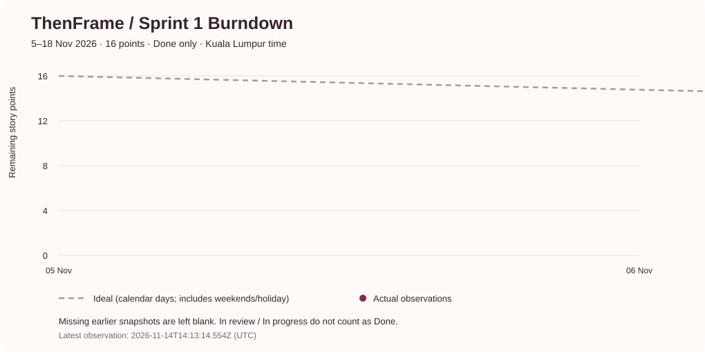

# Sprint 1 — Burndown Chart



Sprint: **5–18 November 2026**. Baseline: **16 story points** from US01–US04 in [PRODUCT_BACKLOG.md](../PRODUCT_BACKLOG.md). Sources: story status from the [GitHub Kanban](https://github.com/users/phangsx25/projects/1); subtask close dates from this repository's issues.

## How points burn

Each story's points are split evenly across its subtasks. When a subtask issue is closed, its share is burned on that day (Kuala Lumpur time). For example, US03 has 5 points and 7 subtasks, so each closed subtask burns about 0.7 points. The chart therefore moves as work inside a story finishes, not only when the whole story reaches Done.

## Latest status — 2026-11-18

| Story | Points | Kanban status | Subtasks closed | Points burned |
| --- | --- | --- | --- | --- |
| [US01](https://github.com/phangsx25/AppDev_G03_AppForge_ThenFrame/issues/1) | 3 | Done | 6/6 | 3 |
| [US02](https://github.com/phangsx25/AppDev_G03_AppForge_ThenFrame/issues/2) | 3 | Done | 6/6 | 3 |
| [US03](https://github.com/phangsx25/AppDev_G03_AppForge_ThenFrame/issues/3) | 5 | Done | 7/7 | 5 |
| [US04](https://github.com/phangsx25/AppDev_G03_AppForge_ThenFrame/issues/4) | 5 | Done | 7/7 | 5 |
| **Total** | **16** | | **26/26** | **16** |

**Remaining: 0 points.**

## Daily values

| Date (Kuala Lumpur) | Subtasks closed | Completed | Remaining |
| --- | --- | --- | --- |
| 2026-11-14 | 0/26 | 0 | 16 |
| 2026-11-15 | 0/26 | 0 | 16 |
| 2026-11-16 | 22/26 | 13.6 | 2.4 |
| 2026-11-17 | 22/26 | 13.6 | 2.4 |
| 2026-11-18 | 26/26 | 16 | 0 |

Values come from the dates subtasks were closed on GitHub, so they show when the board was updated, which can be later than when the work was done. Days before the first board observation (2026-11-14) are not plotted. The dashed ideal line declines linearly from 16 to 0 over calendar days, including weekends and the holiday; it is a reference, not reported work.

## Update

After changing Kanban statuses or closing subtasks, run from the repository root:

```powershell
node scripts/update-burndown.mjs
```

Requires Node.js and GitHub CLI signed in with project read access. If gh is absent from the terminal PATH, set THENFRAME_GH_PATH to its executable path. Story statuses and subtask close dates are saved in [sprint1-burndown.json](sprint1-burndown.json); unchanged same-day runs produce the same file. Outside Sprint 1, history is preserved without adding observations. The script does not modify GitHub cards or issues. [Automatic sync setup](../BURNDOWN_SYNC.md) explains the hourly workflow, required secret and activation steps.
